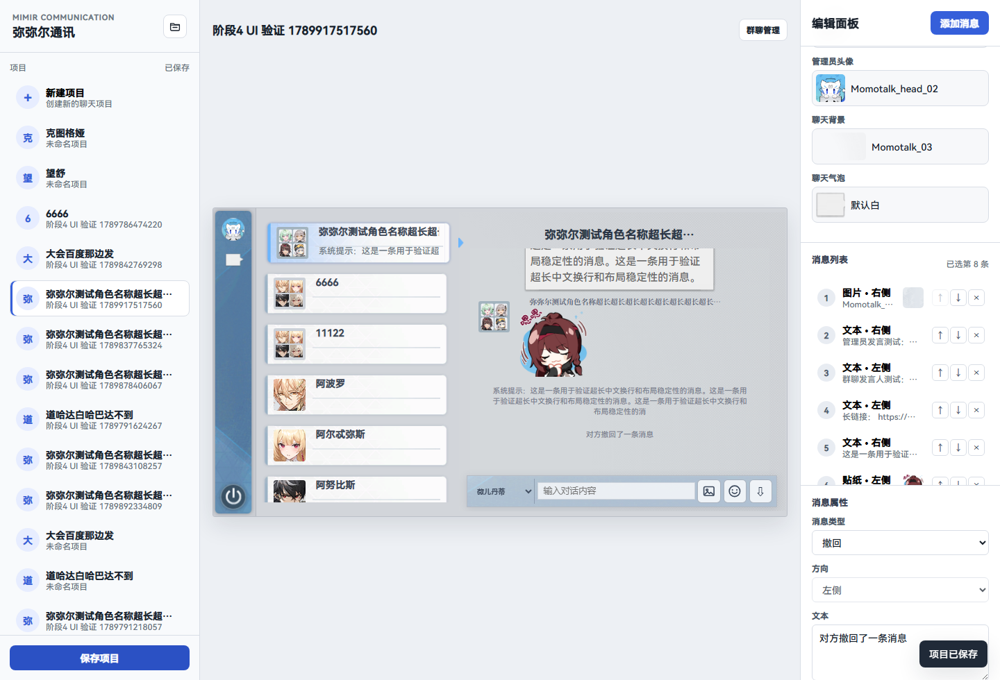
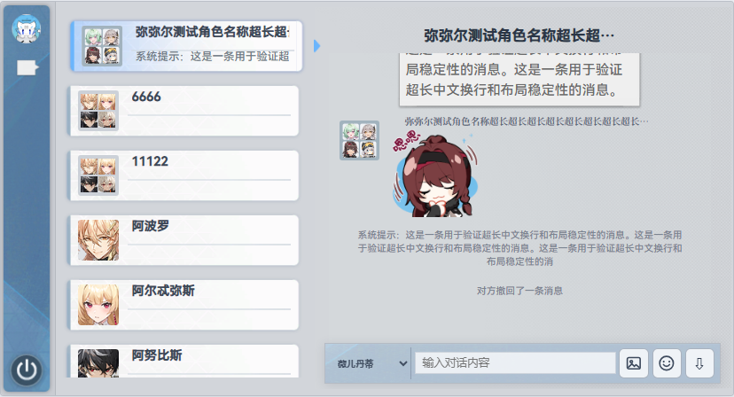
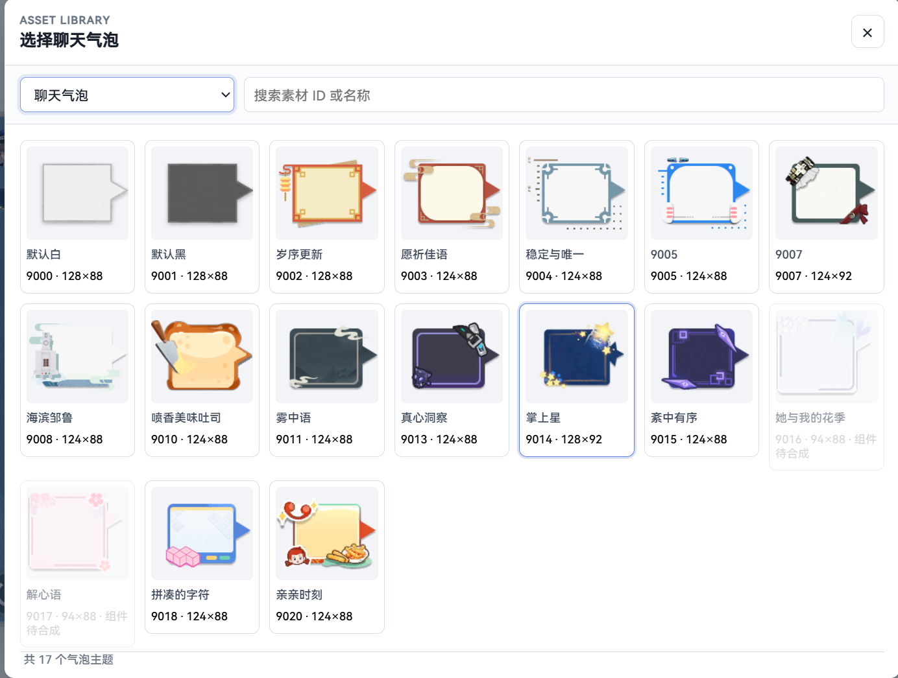
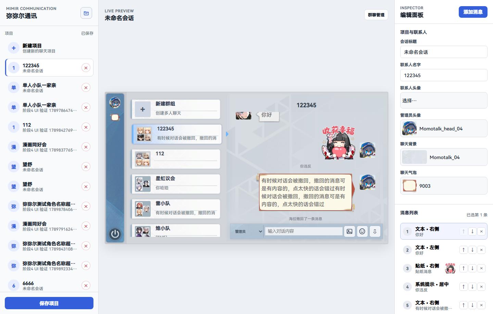
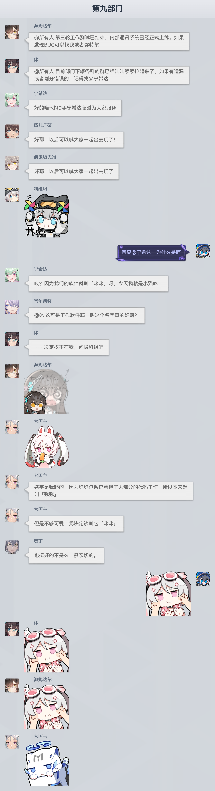

# MimirTalk WebUI

<div align="center">

[](https://github.com/DaydDream/mimirtalk-webui/actions/workflows/ci.yml)
[](https://github.com/DaydDream/mimirtalk-webui/releases/latest)
[](LICENSE)


<br>

<table>
  <tr>
    <td align="center">
      <a href="docs/screenshots/final/最终-编辑器桌面.png"></a><br>
      <sub>编辑器 · 编辑角色对话</sub>
    </td>
    <td align="center">
      <a href="docs/screenshots/final/最终-聊天预览桌面.png"></a><br>
      <sub>聊天预览 · 游戏内效果</sub>
    </td>
  </tr>
  <tr>
    <td align="center" colspan="2">
      <a href="docs/screenshots/final/气泡主题总览.png"></a><br>
      <sub>气泡主题 · 17 组主题</sub>
    </td>
  </tr>
  <tr>
    <td align="center">
      <a href="docs/screenshots/final/项目管理界面.png"></a><br>
      <sub>项目管理 · 本地 JSON 存档</sub>
    </td>
    <td align="center">
      <a href="docs/screenshots/final/长图导出展示.png"></a><br>
      <sub>长图导出 · 一键导出 PNG</sub>
    </td>
  </tr>
</table>

</div>

深空之眼弥弥尔通讯风格的本地聊天编辑器。当前WebUI版本：**1.1.1**。

支持文本、图片、贴纸、系统提示和撤回消息，提供联系人、群聊、气泡主题、聊天预览及本地项目保存。长图按编辑顺序导出全部有效消息，每张最多20条；内容过高时自动继续拆分为PNG。

## 下载与运行

普通用户请从 [Releases](https://github.com/DaydDream/mimirtalk-webui/releases) 下载 `MimirTalk_WebUI_v1.1.1_20261029.zip`，解压到新目录后双击 `启动WebUI.cmd`。Windows x64运行包内置Python与Pillow，无需另行安装。

这是完整包。旧项目和上传图片属于用户数据，更新前请自行备份，不要直接用新包覆盖旧目录。

源码运行需要Python 3.12及以上：

```powershell
python -m pip install -r requirements.txt
python webui/backend/app.py --host 127.0.0.1 --port 8765
```

浏览器访问 `http://127.0.0.1:8765/`。也可使用 `启动WebUI.cmd 8766` 指定端口。

源码仓库不包含游戏解包素材。从同版本WebUI运行包中复制 `assets_source/` 到仓库根目录后，素材即可完整加载。

## 源码目录

```text
webui/
  backend/         桌面HTTP服务、素材索引与项目存储
  frontend/        两端共用前端及实际运行资源
  data/            内置联系人、素材索引与默认数据
  schema/          项目数据格式
  tools/           静态资源及字体构建工具
android/           Android工程与构建入口
shared/contracts/  平台适配与存储接口约定
docs/font-sources/ 官方字体输入、许可及来源信息
examples/          两个简单检查示例
```

安卓端源码与WebUI共用前端，构建方式见 [android/README.md](android/README.md)。WebUI版本与Android应用版本独立维护。

## 字体与构建

界面和正文使用完整Noto Sans SC可变字体，名字使用Noto Serif SC静态700字重；来源、哈希与许可见 `webui/frontend/assets/fonts/manifest.json` 及同目录OFL文件。

```powershell
python -m pip install -r requirements-build.txt
python webui/tools/build_fonts.py
python webui/tools/check_fonts.py
```

FontTools只用于字体构建和校验，普通桌面运行不需要安装。

## 简单示例

```powershell
node examples/check_export_groups.cjs
python examples/check_health.py http://127.0.0.1:8765
```

示例不附带项目夹具、截图、参考图或本地运行日志。

## 说明与许可

核心编辑与导出可离线使用；AI自动对话暂未开放。浏览器可能要求允许一次下载多个文件。

代码使用 [MIT许可证](LICENSE)。游戏素材及字体等第三方资源的权利与许可见 [THIRD_PARTY_NOTICES.md](THIRD_PARTY_NOTICES.md)。本项目为粉丝向工具，与游戏官方无隶属关系。
